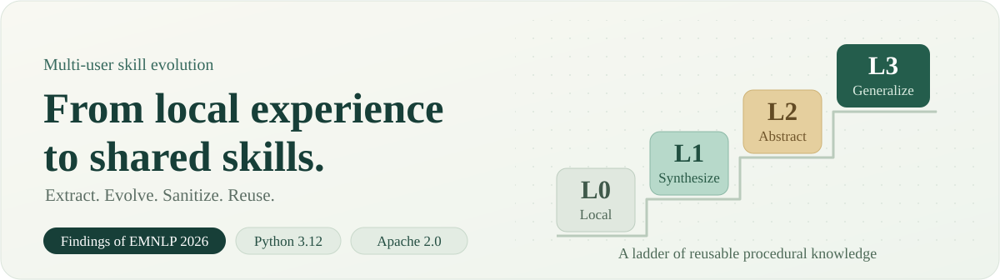
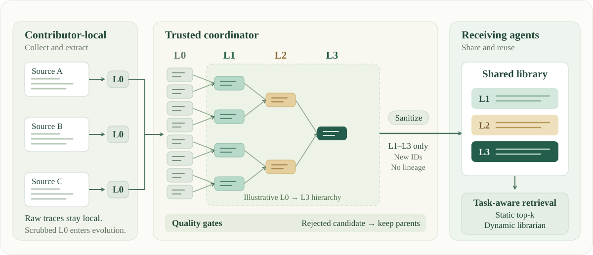

<h1 align="center">🪜 SkillLadder</h1>

<p align="center">
  <strong>Multi-User Skill Evolution with Compliance-Oriented<br/>Synchronization and Quality-Gated Synthesis</strong>
</p>

<p align="center">
  Findings of EMNLP 2026 · Nan Chen, Yi Wang, Bin Benjamin Zhu, Haoyi Xiong
</p>

<p align="center">
  <a href="https://aclanthology.org/2026.findings-emnlp.218/">📄 Paper</a>
  &nbsp;·&nbsp;
  <a href="https://aclanthology.org/2026.findings-emnlp.218.pdf">📑 PDF</a>
  &nbsp;·&nbsp;
  <a href="docs/REPRODUCIBILITY.md">🚀 Reproduction</a>
  &nbsp;·&nbsp;
  <a href="docs/PAPER_TO_CODE.md">🧭 Paper-to-code</a>
  &nbsp;·&nbsp;
  <a href="#citation">📝 Citation</a>
</p>

<p align="center">
  
</p>

SkillLadder turns agent execution traces into a reusable hierarchy of procedural
knowledge. It extracts local L0 skills, synthesizes related contributions into
L1–L3 skills under strongest-parent quality gates, and shares sanitized L1+
skills for task-aware retrieval.

## ✨ At a glance

| 🧩 Extract locally | 🪜 Evolve across contributors | 🔎 Retrieve when useful |
| :--- | :--- | :--- |
| Learn from successful and failed sessions while keeping raw traces local. | Cluster and synthesize related skills, with five quality gates and fallback to parents. | Reuse sanitized skills through static top-k injection or a dynamic librarian. |

## 🗺️ Method overview

<p align="center">
  
</p>

**Local traces → scrubbed L0 → quality-gated evolution → sanitized L1+ → retrieval.**
Parent IDs and source lineage stay internal; shared skills receive separate
release IDs. ER and SA measure entity retention and residual source attribution.
The diagram shows an illustrative hierarchy, not measured skill counts.

<details>
<summary><strong>📦 Repository version and release contents</strong></summary>

This working version implements **corrected reruns** of the paper protocol.
The fixes affect invalid judge responses, baseline candidate pools, source
mixing, runtime quality, and run reuse. Published numbers remain historical
results; checking their changes requires the original local artifacts.

The release includes:

- Core extraction, clustering, synthesis, quality-gating, sanitization, and
  runtime-quality code in `src/fedskill/`.
- Main tau2 experiment drivers and the AWM baseline in `scripts/`.
- Entity-retention, source-attribution, independent judge, cost, clustering,
  and gate-ablation programs in `audits/`.
- Paper configuration, exact task IDs, the pinned tau2 patch, and all prompts.

Traces, generated skills, results, logs, and human annotations remain local.
See [release scope](docs/RELEASE_SCOPE.md) and the
[paper-to-code map](docs/PAPER_TO_CODE.md) for artifact contracts and remaining
numerical-reproduction gaps.

</details>

## 🚀 Quick start

Use **Python 3.12** for the tested rerun environment.

```bash
python3.12 -m venv .venv
source .venv/bin/activate
python -m pip install --upgrade pip
python -m pip install -e ".[dev]"
```

Run the offline checks without credentials or model weights:

```bash
python -m pytest -q -p no:cacheprovider
```

Tests replace model calls and block socket connections. CI also builds the
package and checks the actual patched tau2 agent on its fixed revision.
`requirements-paper.txt` retains the historical direct dependency pins; the
[reproduction guide](docs/REPRODUCIBILITY.md#validated-rerun-environment)
records the current validation environment.

For model-backed runs, use [.env.example](.env.example) as a template and load
its values into your shell. Extraction and evolution use an OpenAI-compatible
endpoint through `SKILLLADDER_API_KEY`, `SKILLLADDER_BASE_URL`, and
`SKILLLADDER_MODEL`.

## 🧪 Reproduce the experiments

Prepare the pinned tau2 checkout using the
[integration guide](integrations/tau2/README.md), then preview all implemented
paper conditions:

```bash
python scripts/run_tau2_comparison.py \
  --tau2-root /path/to/tau2-bench \
  --config configs/paper.yaml --domain airline \
  --agent-model YOUR_LITELLM_AGENT_MODEL \
  --user-model YOUR_LITELLM_USER_MODEL \
  --skill-model YOUR_OPENAI_COMPATIBLE_SONNET_MODEL \
  --conditions baseline,l0-static,l1plus-static,full-static,full-dynamic \
  --output-dir output/airline --dry-run
```

**`--dry-run`** validates local paths and prints effective parameters and
commands. It makes no API calls, downloads no weights, and writes no experiment
artifacts. Remove the flag when ready for an API-backed run.

### Benchmark domains

| ✈️ Airline | 🏦 Banking knowledge | 🛍️ Retail | 📡 Telecom |
| :---: | :---: | :---: | :---: |
| 50 tasks | 97 tasks | 114 tasks | 200 tasks |

YAML selects each domain's exact ordered task IDs. Explicit CLI arguments
override YAML, then compatibility defaults.

### Comparison conditions

| Condition | Skill library | Retrieval |
| --- | --- | --- |
| `baseline` | No skills | Native tau2 agent |
| `l0-static` | All original L0 | Static top-10 |
| `l1plus-static` | Sanitized shared L1+ | Static top-10 |
| `full-static` | Internal final library, including retained L0 | Static top-10 |
| `full-dynamic` | Same internal final library | Dynamic librarian |
| AWM, separate entry point | Original success-only L0 | MiniLM static top-10 |

Full follows Appendix L's internal comparison; L1+ implements the sharing
policy. For **Qwen transfer**, reuse the Sonnet source artifacts with
`--source-artifacts-dir` and keep Sonnet as `--user-model`.

Outputs are separated by fingerprint under `output/<domain>/runs/`.

| Guide | What you will find |
| --- | --- |
| [🚀 Reproducibility](docs/REPRODUCIBILITY.md) | Source-library generation, fixed-library transfer, AWM, resume, and audit commands |
| [🧭 Paper-to-code](docs/PAPER_TO_CODE.md) | Final paper tables mapped to entry points, inputs, outputs, and reproduction status |
| [💰 Costs](docs/COSTS.md) | Historical token/runtime measurements and budget planning |
| [📦 Release scope](docs/RELEASE_SCOPE.md) | Shared fields, local artifacts, and distribution contents |
| [🔌 tau2 integration](integrations/tau2/README.md) | Revision `01e812d1d1c4df6d8d2299bf175e482527112244`, patch setup, and offline checks |

## 🗂️ Repository map

| Path | Purpose |
| --- | --- |
| `src/skillladder/` | Public package surface: `Skill`, `SkillLadderServer` |
| `src/fedskill/` | Reference implementation; historical namespace retained for compatibility |
| `scripts/` | Extraction, evolution, comparison, AWM, and offline integration checks |
| `audits/` | Paper audits and ablations consuming locally generated artifacts |
| `configs/` | Paper configuration and ordered task IDs |
| `integrations/tau2/` | Pinned agent/retrieval patch and setup instructions |
| [prompts/](prompts/README.md) | Index of disclosed prompt templates |
| `docs/` | Reproduction guides, paper mapping, and editable README visuals |

<a name="citation"></a>

## 📝 Citation

If you use SkillLadder, please cite the
[Findings of EMNLP 2026 paper](https://aclanthology.org/2026.findings-emnlp.218/),
pages 4553–4573.

```bibtex
@inproceedings{chen-etal-2026-skillladder,
  title = "{SkillLadder}: Multi-User Skill Evolution with Compliance-Oriented Synchronization and Quality-Gated Synthesis",
  author = "Chen, Nan and Wang, Yi and Zhu, Bin Benjamin and Xiong, Haoyi",
  booktitle = "Findings of the Association for Computational Linguistics: EMNLP 2026",
  month = oct,
  year = "2026",
  address = "Budapest, Hungary",
  publisher = "Association for Computational Linguistics",
  url = "https://aclanthology.org/2026.findings-emnlp.218/",
  doi = "10.18653/2026.findings-emnlp.218",
  pages = "4553--4573"
}
```

Machine-readable metadata is in [CITATION.cff](CITATION.cff).

## ⚖️ License

SkillLadder is released under [Apache 2.0](LICENSE). The tau2 integration
includes MIT-licensed material; see [THIRD_PARTY_NOTICES.md](THIRD_PARTY_NOTICES.md).
